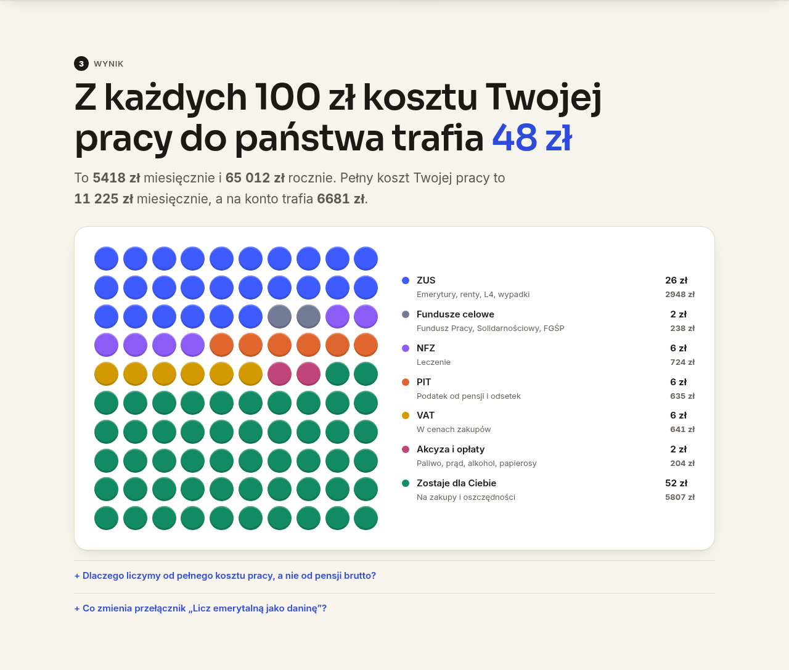
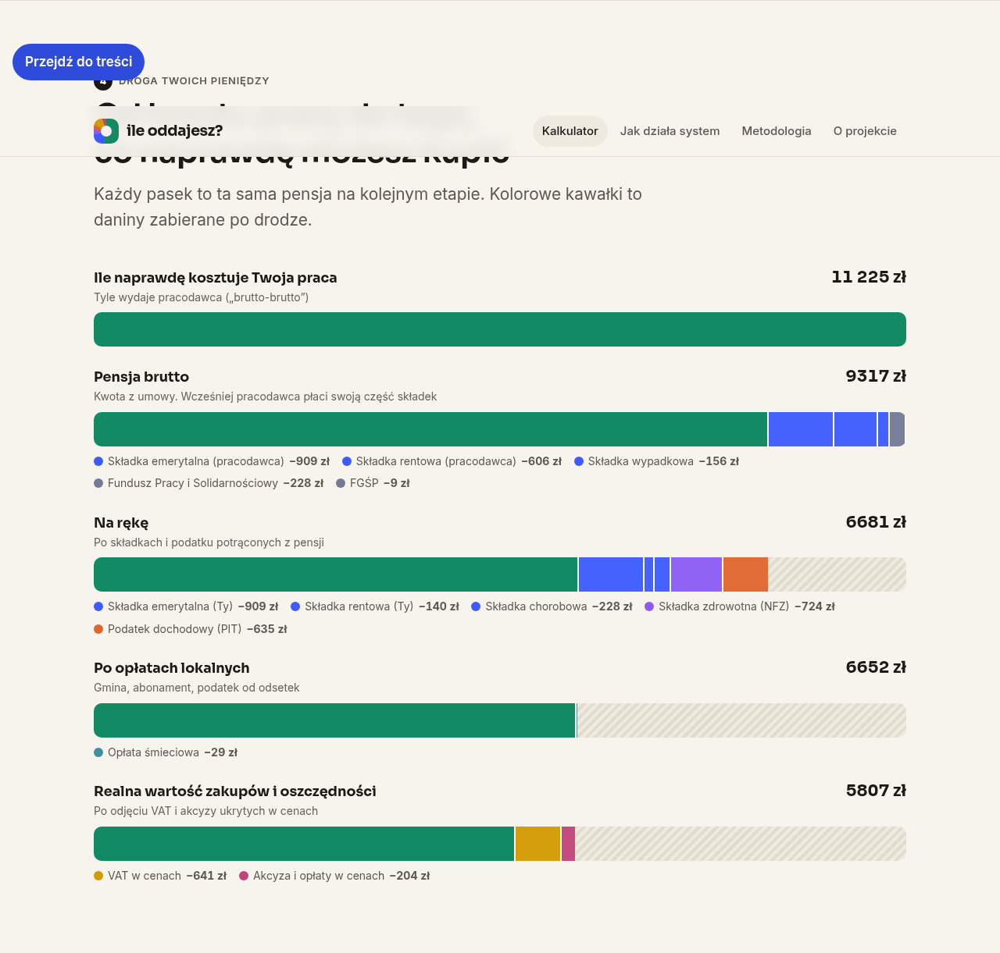
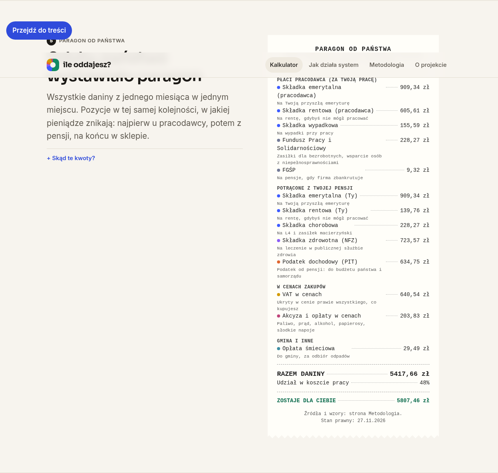
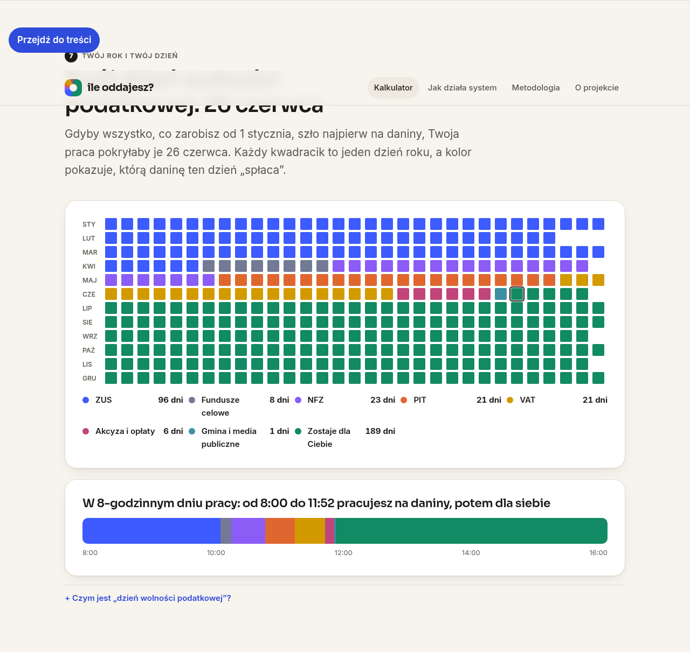
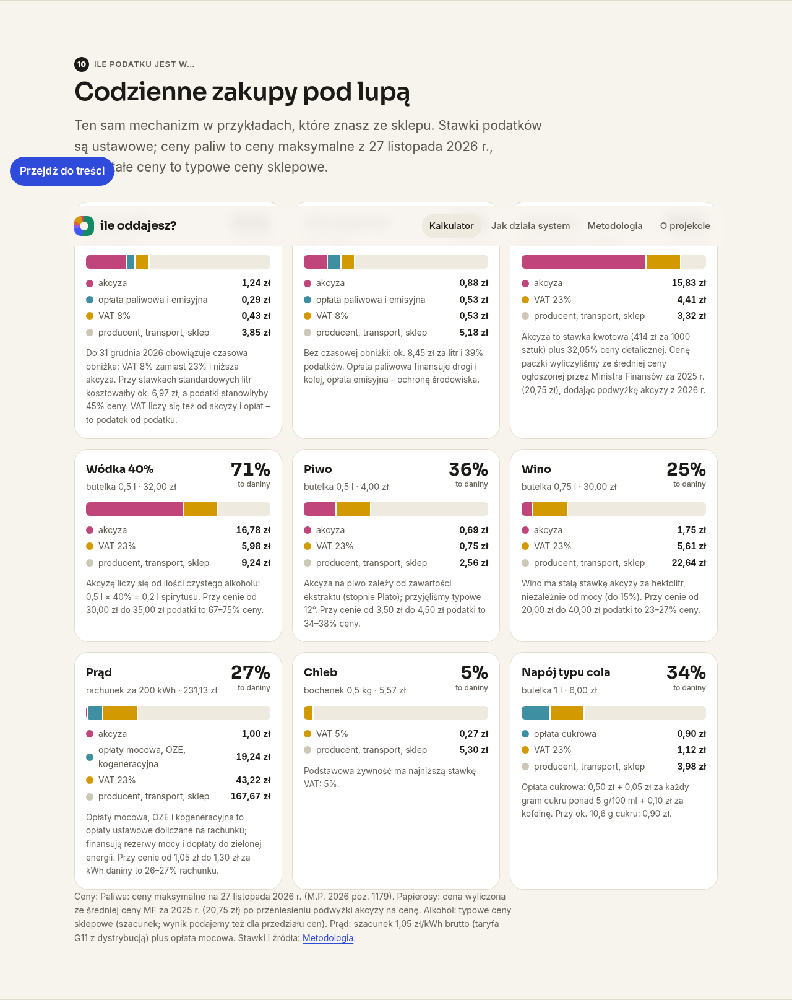
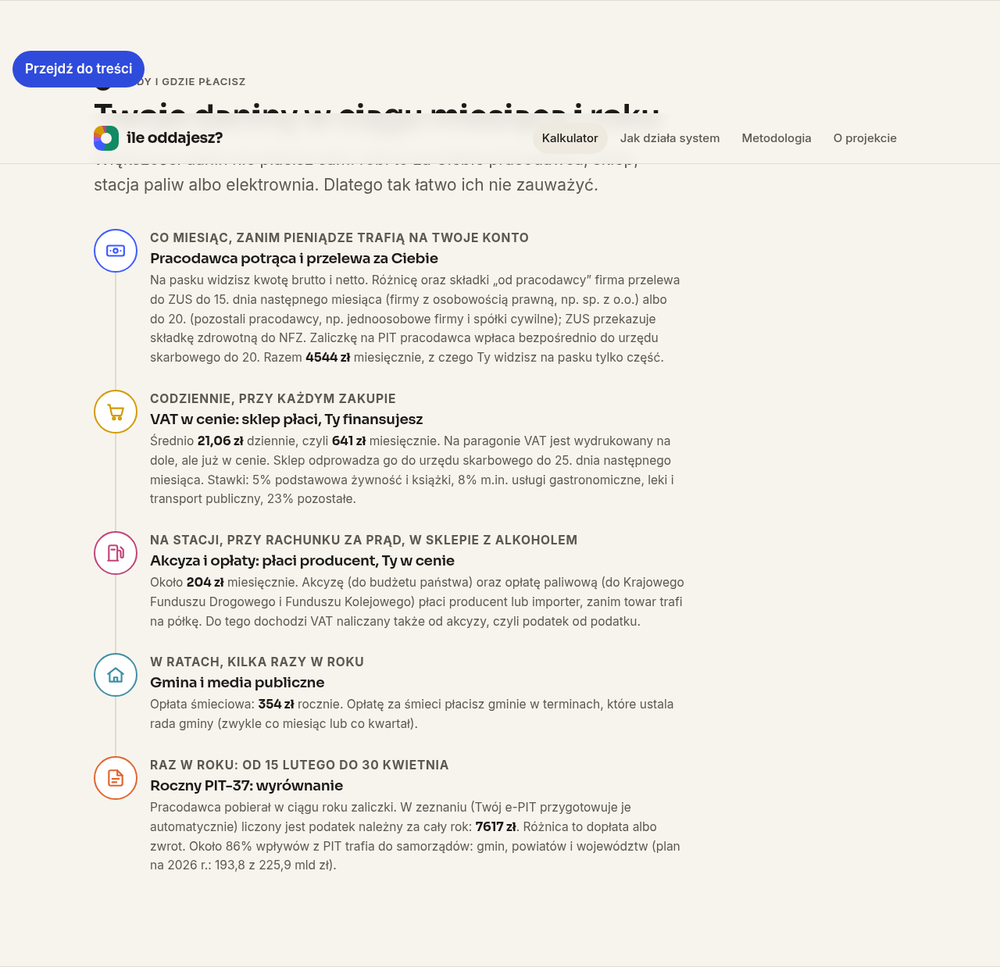
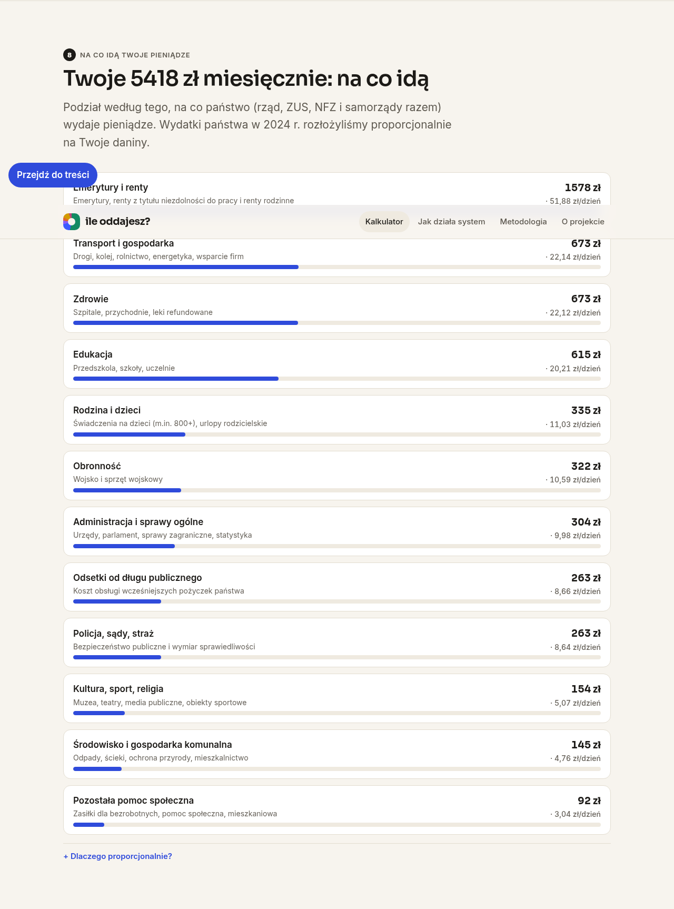
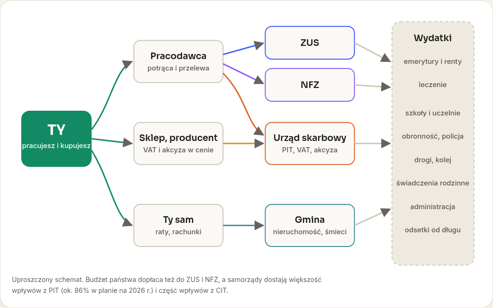
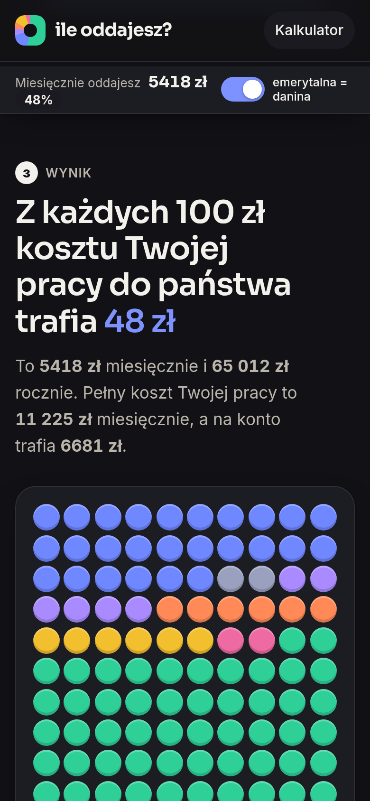

<div align="center">

# Ile oddajesz?

**Edukacyjny kalkulator wszystkich podatków i składek w Polsce.**
Wpisz pensję i zobacz, ile naprawdę trafia do państwa: kiedy, gdzie i na co.

[](src/data/rates-2026.json)
[](#testy-i-jakość)
[](#testy-i-jakość)
[](LICENSE)
[](LICENSE)

**[ileoddajesz.pl](https://ileoddajesz.pl)** · [Metodologia](https://ileoddajesz.pl/metodologia/) · [Zgłoś błąd](https://github.com/NexaITPoland/ileoddajesz/issues/new)



</div>

---

## Spis treści

- [Po co to jest](#po-co-to-jest)
- [Co pokazuje narzędzie](#co-pokazuje-narzędzie)
- [Zasady projektu](#zasady-projektu)
- [Jak liczymy](#jak-liczymy)
- [Źródła danych](#źródła-danych)
- [Szybki start](#szybki-start)
- [Struktura projektu](#struktura-projektu)
- [Silnik obliczeń](#silnik-obliczeń)
- [Testy i jakość](#testy-i-jakość)
- [Publikacja](#publikacja)
- [Coroczna aktualizacja danych](#coroczna-aktualizacja-danych)
- [Ograniczenia i uproszczenia](#ograniczenia-i-uproszczenia)
- [Jak pomóc](#jak-pomóc)
- [FAQ](#faq)
- [Licencja](#licencja)

---

## Po co to jest

Większość danin w Polsce jest niewidoczna dla osoby, która je finansuje:

- **składki „od pracodawcy”** (emerytalna, rentowa, wypadkowa, Fundusz Pracy i Solidarnościowy, FGŚP) nie pojawiają się na pasku płacowym,
- **składki i zaliczkę na PIT** potrąca i przelewa pracodawca, zanim pensja trafi na konto,
- **VAT, akcyza i opłaty celowe** są ukryte w cenach paliwa, prądu, jedzenia czy alkoholu.

„Ile oddajesz?” zbiera to wszystko w jednym miejscu i pokazuje w sposób zrozumiały dla każdego, bez żargonu. Nie ocenia, czy podatki są za wysokie, czy za niskie. Pokazuje fakty i obie strony rachunku: ile płacisz i co państwo za to finansuje.

### Dlaczego nie istniejące narzędzia?

Przed rozpoczęciem przejrzeliśmy podobne narzędzia w Polsce i na świecie (notatki: [`research/world-portals.md`](research/world-portals.md)). Kalkulatory brutto-netto kończą się na wypłacie. Raporty think-tanków (np. WEI) podają średnią dla „przeciętnego Polaka”, bez możliwości wpisania własnych danych. Dzień Wolności Podatkowej jest liczony dla całej gospodarki. Nie znaleźliśmy narzędzia, które dla konkretnej osoby łączy koszt pracy, składki, PIT i podatki w cenach zakupów, a do tego wyjaśnia, kiedy i gdzie pieniądze płyną.

---

## Co pokazuje narzędzie

Kalkulator prowadzi przez wynik jak przez opowieść: każdy krok to jedna myśl i jedna wizualizacja.

| # | Sekcja | Co widzisz |
|---|---|---|
| 1 | **Twoja pensja** | Kwota brutto lub na rękę; umowa o pracę, zlecenie albo B2B (liniowy, ryczałt, skala; duży, preferencyjny lub zerowy ZUS); ulga dla młodych |
| 2 | **Zgadnij** | Zanim zobaczysz wynik, zgadujesz, ile z każdych 100 zł trafia do państwa. Potem porównujesz (efekt przewidywania, ang. *pretesting*, poprawia zapamiętywanie) |
| 3 | **100 monet** | Z każdych 100 zł kosztu pracy: ile monet idzie do ZUS, NFZ, PIT, VAT, akcyzy, a ile zostaje |
| 4 | **Droga pieniędzy** | Kurczący się pasek: koszt pracy → brutto → na rękę → realna wartość zakupów |
| 5 | **Paragon od państwa** | Wszystkie daniny miesiąca lub roku na „paragonie”, w kolejności, w jakiej znikają |
| 6 | **Kiedy i gdzie płacisz** | Oś czasu: kto przelewa (pracodawca, sklep, producent), do kiedy (15./20./25. dnia, raty, 30 kwietnia) i dokąd |
| 7 | **Twój rok i dzień** | Osobisty dzień wolności podatkowej na kalendarzu 365 dni oraz „zegar” 8-godzinnego dnia pracy |
| 8 | **Na co idą pieniądze** | Twoje daniny rozłożone na funkcje państwa (emerytury, zdrowie, edukacja…), w zł miesięcznie i dziennie |
| 9 | **Druga strona rachunku** | Ile państwo wydaje na przeciętnego mieszkańca, deficyt, porównanie z UE |
| 10 | **Ile podatku jest w…** | Litr paliwa, paczka papierosów, wódka, piwo, wino, rachunek za prąd, chleb, cola |
| 11 | **Dopasuj do siebie** | Gospodarstwo domowe, dzieci, druga osoba zarabiająca, własne zużycie paliwa, prądu, papierosów i alkoholu, mieszkanie, odsetki |
| 12 | **Podziel się** | Obrazek do udostępnienia (tylko procenty i data, bez kwot) i link z ustawieniami |

Przełącznik **„Licz emerytalną jako daninę”** działa we wszystkich sekcjach. Składki emerytalne i rentowe można traktować jak daninę (tak liczy OECD) albo jak odkładanie na własną emeryturę.

<table>
<tr>
<td width="50%"></td>
<td width="50%"></td>
</tr>
<tr>
<td></td>
<td></td>
</tr>
<tr>
<td></td>
<td></td>
</tr>
</table>

Dodatkowe strony:

- **[Jak działa system](https://ileoddajesz.pl/jak-dziala-system/)**: schemat przepływu pieniędzy, trzy drogi płacenia danin, tabela „kto, kiedy, gdzie, ile”, quiz utrwalający (5 pytań z wyjaśnieniami) i słowniczek.
- **[Metodologia](https://ileoddajesz.pl/metodologia/)**: każdy parametr z wartością, podstawą prawną i linkiem do źródła; koszyk zakupów, przykład wzorcowy, lista uproszczeń.
- **[O projekcie](https://ileoddajesz.pl/o-projekcie/)**: neutralność, dokładność, zgłaszanie błędów.
- **[Prywatność i zasady](https://ileoddajesz.pl/prywatnosc/)**.

<p align="center"></p>

<p align="center"></p>

---

## Zasady projektu

### 1. Zrozumiałość dla każdego

- Jedna myśl na ekran; szczegóły dopiero po rozwinięciu („progressive disclosure”).
- Złotówki i rzeczy zamiast procentów: „z każdych 100 zł…”, „bułka”, „litr benzyny”.
- Zero żargonu w pierwszej warstwie: każdy skrót (ZUS, PIT, VAT) ma podpis po ludzku.
- Kolor zawsze znaczy to samo: zielony = Twoje, pozostałe kolory = kolejne daniny. Bez czerwieni alarmowej.
- Przy każdej liczbie można rozwinąć „skąd to wiemy?”.

### 2. Neutralność

- Żadnych nazwisk polityków ani nazw partii: pilnuje tego automatyczna bramka w buildzie ([`scripts/gates.mjs`](scripts/gates.mjs)).
- Kategorie wydatków z oficjalnej klasyfikacji COFOG, a nie z własnego podziału.
- Obie strony rachunku: daniny i to, co państwo finansuje (wraz z deficytem).
- Dwie interpretacje składek emerytalnych (przełącznik), bo w tej sprawie ekonomiści się różnią.

### 3. Weryfikowalność

- Jedno źródło liczb: [`src/data/rates-2026.json`](src/data/rates-2026.json). Liczy z niego kalkulator i z niego powstaje strona Metodologia, więc nie mogą się rozjechać.
- Każdy parametr ma przypisane źródło (`refs` → `sources`): ustawę, rozporządzenie, obwieszczenie, publikację GUS, Eurostatu, URE lub ZUS.
- Silnik ma testy zgodności z niezależnymi wyliczeniami wzorcowymi (co do grosza).
- Kod i dane są otwarte; każdy może sprawdzić wzory i zgłosić błąd.

### 4. Prywatność

- Obliczenia działają w całości w przeglądarce. Nie ma backendu, bazy danych ani kont.
- Ustawienia trafiają tylko do części adresu po `#`, której przeglądarka nie wysyła do serwera.
- Brak cookies, analityki i zasobów z obcych domen (czcionki są hostowane lokalnie). Ścisła polityka CSP.

---

## Jak liczymy

**Punkt wyjścia to pełny koszt pracy** („brutto-brutto”): pensja brutto plus składki płacone przez pracodawcę. Tak samo robi OECD w raporcie *Taxing Wages*. Przy B2B punktem wyjścia jest przychód minus koszty firmy.

```
koszt pracy  ──►  − składki pracodawcy (ZUS, FP+FS, FGŚP)       ──►  brutto
brutto       ──►  − składki pracownika, zdrowotna, PIT          ──►  na rękę
na rękę      ──►  − opłaty lokalne (śmieci, RTV, nieruchomość)  ──►  do wydania
do wydania   ──►  − oszczędności  →  wydatki  →  VAT + akcyza   ──►  realna wartość zakupów
```

1. **Składki i PIT** liczone są dla całego roku, jak w rocznym zeznaniu: próg 120 000 zł, kwota wolna 30 000 zł, koszty uzyskania przychodu, roczny limit składek (30-krotność, 282 600 zł; dotyczy też FP, FS i FGŚP), ulga dla młodych (z proporcjonalnym odliczeniem składek), ulga prorodzinna ze zwrotem nadwyżki, danina solidarnościowa.
2. **VAT i akcyza** liczone są z wydatków. Dochód netto minus oszczędności rozkładamy na 16 kategorii według struktury wydatków gospodarstw domowych o podobnym dochodzie (GUS, *Budżety gospodarstw domowych w 2025 r.*, kwintyle). W każdej kategorii liczymy, jaka część ceny to VAT (mapowanie 68 pozycji na stawki z załączników ustawy o VAT) i akcyza. Jeśli użytkownik poda własne zużycie paliwa, prądu, papierosów lub alkoholu, liczymy je dokładnie ze stawek ustawowych, a resztę koszyka proporcjonalnie zmniejszamy.
3. **Udział danin** = suma danin ÷ pełny koszt pracy.
4. **Dzień wolności podatkowej** = udział × liczba dni w roku, licząc od 1 stycznia. **Zegar** = udział × 8 godzin, od 8:00.
5. **Na co idą pieniądze**: proporcjonalnie do struktury wydatków sektora instytucji rządowych i samorządowych (Eurostat, COFOG 2024). Tak samo robią „paragony podatkowe” urzędów skarbowych Wielkiej Brytanii i Australii.

Przykład dla przeciętnego wynagrodzenia (9 317,01 zł brutto, GUS, III kwartał 2026), umowa o pracę:

| | miesięcznie |
|---|---:|
| Pełny koszt pracy | 11 225 zł |
| Na konto | 6 681 zł |
| Wszystkie daniny (z emerytalną) | 5 418 zł |
| Udział danin w koszcie pracy | **48%** |
| Osobisty dzień wolności podatkowej | 26 czerwca |

---

## Źródła danych

Pełna lista z linkami jest na stronie [Metodologia](https://ileoddajesz.pl/metodologia/#zrodla) i w polu `sources` pliku danych. Najważniejsze:

| Obszar | Źródło pierwotne |
|---|---|
| PIT | Ustawa o podatku dochodowym od osób fizycznych, t.j. Dz.U. 2026 poz. 592 |
| Składki społeczne | Ustawa o systemie ubezpieczeń społecznych, t.j. Dz.U. 2026 poz. 1474; obwieszczenie MRPiPS, M.P. 2025 poz. 1206 (limit 282 600 zł) |
| Składka zdrowotna | Ustawa o świadczeniach opieki zdrowotnej, t.j. Dz.U. 2025 poz. 1461; komunikat ZUS o składkach w 2026 r.; M.P. 2025 poz. 1274 (limit odliczenia 14 100 zł) |
| FP, FS, FGŚP | Ustawa budżetowa na 2026 r., Dz.U. 2026 poz. 62, art. 25–27 |
| Płaca minimalna | Rozporządzenie RM, Dz.U. 2025 poz. 1242 (4 806 zł) |
| VAT | Ustawa o VAT, t.j. Dz.U. 2026 poz. 1263 (art. 41, 43, 146ef, załączniki 3 i 10) |
| Akcyza | Ustawa o podatku akcyzowym, t.j. Dz.U. 2026 poz. 412; Dz.U. 2024 poz. 1681 (mapa akcyzowa tytoniu) |
| Paliwa | Dz.U. 2026 poz. 1288 i 1289 (czasowa obniżka VAT i akcyzy do 31.12.2026); M.P. 2026 poz. 1179 (ceny maksymalne); M.P. 2025 poz. 1238 (opłata paliwowa) |
| Papierosy | M.P. 2026 poz. 205 (średnia cena 2025), M.P. 2025 poz. 1273 (cena do akcyzy minimalnej 2026) |
| Prąd | Informacje Prezesa URE nr 58/2025 (opłata mocowa) i 61/2025 (OZE); Dz.U. 2025 poz. 1664 (kogeneracyjna) |
| Opłaty lokalne | M.P. 2025 poz. 726 (podatek od nieruchomości), Dz.U. 2025 poz. 885 (abonament RTV) |
| Wydatki gospodarstw | GUS, *Budżety gospodarstw domowych w 2025 r.* (29.09.2026), tabl. 2, 19, 30, 37a |
| Wydatki państwa | Eurostat `gov_10a_exp` (COFOG 2024), `gov_10a_main`, `gov_10a_taxag`, `nasa_10_ki` |
| Porównania | Centrum im. Adama Smitha (Dzień Wolności Podatkowej 2026), OECD *Taxing Wages 2026* |

Notatki z weryfikacji (wartości, podstawy prawne, adresy, niepewności) są w katalogu [`research/`](research/):

- [`labor-2026.md`](research/labor-2026.md): PIT, ZUS, zdrowotna, B2B, terminy (133 ze 136 wartości potwierdzone w źródłach pierwotnych),
- [`consumption-2026.md`](research/consumption-2026.md): VAT, akcyza, opłaty, ceny, przykłady,
- [`data-2026.md`](research/data-2026.md): GUS, efektywny VAT, COFOG, budżet, makro,
- [`world-portals.md`](research/world-portals.md): przegląd 15 podobnych narzędzi na świecie i wnioski projektowe.

Po zebraniu danych przeprowadzono **niezależny audyt** (osobna weryfikacja w tekstach źródłowych). Wszystkie wykryte błędy poprawiono i zabezpieczono testami regresyjnymi.

---

## Szybki start

Wymagania: **Node.js 22.18+** (zalecane 24) i npm. Do testów e2e: Google Chrome (`/usr/bin/google-chrome` albo zmienna `CHROME_PATH`).

```bash
git clone https://github.com/NexaITPoland/ileoddajesz.git
cd ileoddajesz
npm install

npm run dev        # tryb deweloperski z odświeżaniem: http://localhost:4321
```

Wersja produkcyjna lokalnie:

```bash
npm run build      # sprawdzenie typów + build + nagłówki CSP + bramki jakości
npm run preview    # serwuje dist/ na http://localhost:4400
```

Wszystkie komendy:

| Komenda | Co robi |
|---|---|
| `npm run dev` | Serwer deweloperski Astro |
| `npm run check` | Sprawdzenie typów (`astro check`) |
| `npm run build` | Typy, build statyczny, `dist/_headers` (CSP z hashami), bramki jakości |
| `npm run preview` | Serwuje `dist/` jak Cloudflare (czyste adresy, strona 404) |
| `npm test` | Testy silnika obliczeń (Vitest) |
| `npm run test:e2e` | Testy w przeglądarce (Playwright + axe); wymagają `npm run build` |
| `node scripts/og.mjs` | Generuje obrazek podglądu linku `public/og.png` |
| `node scripts/screenshots.mjs` | Odświeża zrzuty do README (wymaga `npm run preview`) |

---

## Struktura projektu

```
.
├── src/
│   ├── data/rates-2026.json      # JEDYNE źródło liczb: stawki, dane, źródła (sources) i przypisania (refs)
│   ├── lib/engine/               # silnik obliczeń (czyste funkcje, bez DOM)
│   │   ├── labor.ts              #   składki, PIT, umowa o pracę, zlecenie, B2B, wypłata styczniowa
│   │   ├── consumption.ts        #   koszyk GUS, VAT, akcyza, paliwo, papierosy, alkohol, prąd
│   │   ├── index.ts              #   całość, przełącznik ZUS, dzień wolności, zegar, COFOG
│   │   └── types.ts              #   typy pliku danych
│   ├── scripts/app.ts            # kalkulator i wszystkie wizualizacje (czysty TS + SVG/CSS)
│   ├── components/Products.astro # „Ile podatku jest w…” (liczone przy buildzie)
│   ├── layouts/Base.astro        # szkielet strony, meta, nawigacja, stopka
│   ├── pages/                    # index, jak-dziala-system, metodologia, o-projekcie, prywatnosc, 404
│   └── styles/global.css         # tokeny kolorów (jasny i ciemny motyw), typografia, komponenty
├── tests/
│   ├── unit/engine.test.ts       # 39 testów silnika, w tym zgodność z wyliczeniami wzorcowymi
│   └── e2e/site.spec.ts          # 9 testów: ścieżka użytkownika, mobile 375 px, WCAG AA, oba motywy
├── scripts/
│   ├── gates.mjs                 # bramki: zero obcych domen, neutralność, meta, H1, martwe linki, placeholdery
│   ├── headers.mjs               # dist/_headers: CSP z hashami, HSTS, nosniff, Permissions-Policy, cache
│   ├── build-basket.py           # buduje koszyk zakupów z danych GUS (przy corocznej aktualizacji)
│   ├── og.mjs, screenshots.mjs   # obrazek OG i zrzuty do README
│   └── serve-dist.mjs            # lokalny serwer dist/ (podgląd i testy e2e)
├── research/                     # notatki z weryfikacji źródeł i przegląd podobnych narzędzi
├── docs/screenshots/             # zrzuty ekranu do README
├── public/                       # czcionki (Inter, Sora + licencje OFL), favicon, og.png, robots.txt
└── wrangler.jsonc                # konfiguracja Cloudflare Workers Static Assets
```

---

## Silnik obliczeń

Silnik to czyste funkcje TypeScript bez zależności od przeglądarki. Ten sam kod liczy wynik na stronie, w testach i na stronie Metodologia.

```ts
import rates from './src/data/rates-2026.json';
import { compute, freedomDay, type Rates } from './src/lib/engine';

const R = rates as unknown as Rates;
const r = compute({
  people: [{ contract: 'uop', amount: 8000, amountIs: 'gross', under26: false }],
  basket: { persons: 1, fuelLitersMonthly: 60 },
  zusAsTax: true,
}, R);

r.share;                                  // 0.479 – udział danin w koszcie pracy
r.slices;                                 // pozycje paragonu: { id, group, label, plain, amount, payer }
freedomDay(r.share, 2026);                // Date – osobisty dzień wolności podatkowej
```

Najważniejsze funkcje:

| Funkcja | Opis |
|---|---|
| `computeLabor(input, R)` | Roczne składki i PIT dla umowy o pracę, zlecenia lub B2B |
| `grossFromNet(net, input, R)` | Odwrotność: brutto (lub przychód) dla zadanego średniego „na rękę” |
| `januaryPayslip(gross, R)` | Pierwsza wypłata w roku, jak na pasku płacowym (do porównań z kalkulatorami płac) |
| `computeConsumption(net, basket, R)` | VAT i akcyza w wydatkach (koszyk GUS + własne zużycie) |
| `fuelUnit`, `packUnit`, `alcoholUnit`, `electricityMonthly` | Podatki w jednostce produktu |
| `compute(input, R)` | Całość: praca + zakupy + opłaty lokalne, z przełącznikiem ZUS |
| `freedomDay`, `workClock`, `whereItGoes` | Kalendarz, zegar, podział na funkcje państwa |

---

## Testy i jakość

```bash
npm test            # 39 testów jednostkowych
npm run build       # bramki jakości (zatrzymują build przy błędzie)
npm run test:e2e    # 9 testów w przeglądarce
```

**Testy jednostkowe** sprawdzają m.in.:

- zgodność z wyliczeniami wzorcowymi co do grosza: płaca minimalna 3 605,85 zł na rękę i 5 790,28 zł kosztu pracodawcy, duży ZUS 1 926,76 zł, preferencyjny 456,18 zł,
- podatki w produktach zgodne z niezależnymi wyliczeniami: benzyna 1,96 zł (33,7%; 44,8% przy stawkach standardowych), olej napędowy 1,94 zł, papierosy 20,24 zł, wódka 22,77 zł, piwo 1,44 zł,
- przypadki brzegowe: próg podatkowy, kwota wolna, limit 30-krotności (także FP, FS i FGŚP), ulga dla młodych, ulga prorodzinna z limitem dochodu małżonków, progi opłaty mocowej,
- spójność danych: koszyk i COFOG sumują się do 100%, każdy parametr ma źródło z adresem HTTPS,
- spójność bilansu: daniny + to, co zostaje = koszt pracy, monotoniczność netto względem brutto.

**Testy e2e** (Playwright + axe-core) sprawdzają:

- pełną ścieżkę: wpisanie pensji → zgadywanie → wynik (100 monet, paragon, kalendarz 365 dni, 12 funkcji państwa),
- odtwarzanie wyniku z linku i działanie przełącznika ZUS, umowy B2B i zlecenia,
- brak przewijania w poziomie na telefonie (375 px) na każdej stronie,
- **zero naruszeń WCAG 2.1 A/AA** (axe) i kontrast w jasnym i ciemnym motywie,
- brak błędów w konsoli.

**Bramki w buildzie** ([`scripts/gates.mjs`](scripts/gates.mjs)) zatrzymują publikację, jeśli:

- jakakolwiek strona ładuje zasób z obcej domeny,
- w treści pojawi się nazwa partii, nazwisko polityka albo słowo nacechowane („haracz”, „grabież”…),
- brakuje tytułu, opisu, canonical albo jest więcej niż jeden H1,
- link wewnętrzny prowadzi donikąd,
- w treści zostało `undefined`, `NaN`, `TODO` albo „lorem ipsum”.

Rozmiar: cała strona ok. 0,5 MB, skrypt kalkulatora ok. 56 KB razem z kompletem danych i źródeł.

---

## Publikacja

Strona jest w pełni statyczna i hostowana na **Cloudflare Workers Static Assets** (darmowy plan dopuszcza użytek komercyjny, bez limitu transferu).

```bash
# 1. Build z adresem docelowym; PUBLIC_INDEXABLE=true zdejmuje blokadę indeksowania (X-Robots-Tag: noindex)
PUBLIC_SITE_URL=https://ileoddajesz.pl PUBLIC_INDEXABLE=true npm run build

# 2. Publikacja (przy pierwszym razie: npx wrangler login)
npx wrangler deploy

# 3. Domena: w panelu Cloudflare → Workers → ileoddajesz → Settings → Domains & Routes → Add custom domain
```

Zmienne środowiskowe przy buildzie:

| Zmienna | Domyślnie | Znaczenie |
|---|---|---|
| `PUBLIC_SITE_URL` | `https://ileoddajesz.pl` | Adres kanoniczny i adresy w tagach Open Graph |
| `PUBLIC_INDEXABLE` | brak | `true` = strona widoczna w wyszukiwarkach; bez tego build dodaje `noindex` (bezpieczny podgląd) |
| `PUBLIC_REPO_URL` | `https://github.com/NexaITPoland/ileoddajesz` | Link do repozytorium i zgłaszania błędów |

---

## Coroczna aktualizacja danych

Stawki zmieniają się co roku (część już jest uchwalona na 2027 r. – patrz `research/*-2026.md`, sekcje o 2027). Aktualizacja zajmuje kilka godzin:

1. **Skopiuj plik danych:** `src/data/rates-2026.json` → `rates-2027.json` i zmień import we wszystkich plikach, które go używają (`grep -rl rates-2026 src tests`).
2. **Zaktualizuj parametry** według tabel na stronie Metodologia (każdy wiersz ma źródło; sprawdź nowe obwieszczenia: prognozowane wynagrodzenie, limit 30-krotności, płaca minimalna, składki ZUS przedsiębiorców, składka zdrowotna, opłata paliwowa, stawki URE, abonament RTV, górne stawki podatków lokalnych, średnia cena papierosów).
3. **Koszyk zakupów:** po publikacji nowych *Budżetów gospodarstw domowych* GUS (zwykle we wrześniu) uruchom `python3 -I scripts/build-basket.py research/data-2027.json units.json`.
4. **COFOG i makro:** nowe dane Eurostatu (`gov_10a_exp`, `gov_10a_main`, `gov_10a_taxag`) i GUS (ludność).
5. **Zaktualizuj `meta`** (`year`, `asOf`, `version`) i oczekiwane wartości w testach wzorcowych.
6. `npm test && npm run build && npm run test:e2e`, przejrzyj stronę Metodologia, odśwież zrzuty (`node scripts/screenshots.mjs`).

---

## Ograniczenia i uproszczenia

Uczciwie o tym, czego narzędzie nie robi (pełna lista: [Metodologia → Uproszczenia](https://ileoddajesz.pl/metodologia/#uproszczenia)):

- **VAT i akcyza to dolna granica.** Szacunek obejmuje tylko podatki w cenach dóbr kupowanych przez gospodarstwa domowe. W badaniach GUS ludzie zaniżają wydatki na alkohol i papierosy, a VAT ukryty w cenach usług zwolnionych (np. najmu, usług finansowych) nie jest liczony. Rzeczywista kwota jest raczej wyższa. Dlatego warto podać własne zużycie w sekcji „Dopasuj”.
- **Ceny alkoholu i prądu to przedziały rynkowe**, bo nie znaleźliśmy publikowanej średniej ceny. Karty produktów pokazują wynik dla całego przedziału. Cenę papierosów wyliczamy z oficjalnej średniej ceny MF.
- **Struktura wydatków na alkohol** (47% mocne alkohole, 44% piwo, 9% wino) to założenie projektu na podstawie doniesień prasowych o rynku.
- **Paliwa** liczone są według stawek obowiązujących w dniu aktualizacji (czasowa obniżka do 31.12.2026). W części roku obowiązywały stawki standardowe.
- **Pensja stała przez cały rok**; bez premii, PPK (to oszczędności, nie danina), ulgi dla rodzin 4+, ulgi na powrót, ulg odliczanych od dochodu.
- **Składka wypadkowa:** stawka dla firm do 9 ubezpieczonych (1,67%).
- **Podatki płacone przez firmy** (CIT, podatek od nieruchomości firm) częściowo przenoszą się na ceny, ale nie są liczone. To kolejny powód, dla którego wynik jest raczej zaniżony.
- **„Na co idą pieniądze”** to podział proporcjonalny, a nie śledzenie konkretnej złotówki.
- **To nie jest porada podatkowa** ani kalkulator do rozliczeń z urzędem.

---

## Jak pomóc

- **Znalazłeś błąd w liczbach lub przepisach?** [Otwórz zgłoszenie](https://github.com/NexaITPoland/ileoddajesz/issues/new). Podaj, co wpisałeś, co wyszło, co powinno wyjść, i najlepiej link do źródła pierwotnego (Dziennik Ustaw, Monitor Polski, ZUS, GUS).
- **Chcesz poprawić kod lub treść?** Fork → gałąź → zmiana → `npm test && npm run build && npm run test:e2e` → pull request. Zmiany w liczbach muszą mieć źródło w `sources` i przypisanie w `refs`, a jeśli to możliwe – test wzorcowy.
- **Treści** piszemy prosto i neutralnie: bez ocen, bez nazwisk polityków i nazw partii, każde twierdzenie z podstawą.
- **Wykorzystaj w szkole lub artykule** – treści są na licencji CC BY 4.0; wystarczy podać źródło.

---

## FAQ

**Czy to oficjalne narzędzie?**
Nie. To niezależny projekt edukacyjny, niezwiązany z żadną instytucją publiczną, partią ani organizacją polityczną. Nazwy instytucji podajemy wyłącznie jako źródła danych.

**Dlaczego wynik jest wyższy niż „klin podatkowy” OECD?**
OECD liczy klin tylko dla podatków i składek od pracy, a my dodajemy VAT, akcyzę i opłaty w cenach. OECD stosuje też własną definicję przeciętnego wynagrodzenia i klasyfikacji danin.

**Dlaczego mój dzień wolności podatkowej różni się od tego z mediów?**
Centrum im. Adama Smitha liczy jeden dzień dla całej Polski z relacji wszystkich wydatków publicznych do PKB (łącznie z deficytem). My liczymy z Twoich własnych danin.

**Czy składki emerytalne to podatek?**
To kwestia sporna, dlatego jest przełącznik. Składki zwiększają Twoją przyszłą emeryturę (indywidualne konto w ZUS), ale są obowiązkowe, a dzisiejsze wpłaty od razu finansują dzisiejszych emerytów.

**Czy moje dane gdzieś trafiają?**
Nie. Wszystko liczy się w przeglądarce. Strona nie ma serwera aplikacji, bazy danych, cookies ani analityki.

---

## Licencja

- **Kod:** [MIT](LICENSE).
- **Treści, metodologia i dane** (`src/pages`, `src/data`, `research`): [CC BY 4.0](https://creativecommons.org/licenses/by/4.0/deed.pl).
- **Czcionki** Inter i Sora: [SIL Open Font License 1.1](public/fonts/).
- Wszystkie zależności są na licencjach MIT, Apache-2.0 lub MPL-2.0 i dopuszczają użytek komercyjny.

<div align="center">
<sub>Stan prawny i dane na 27 listopada 2026 r. Wyniki to szacunki edukacyjne, a nie porada podatkowa ani wyliczenie urzędowe.</sub>
</div>
